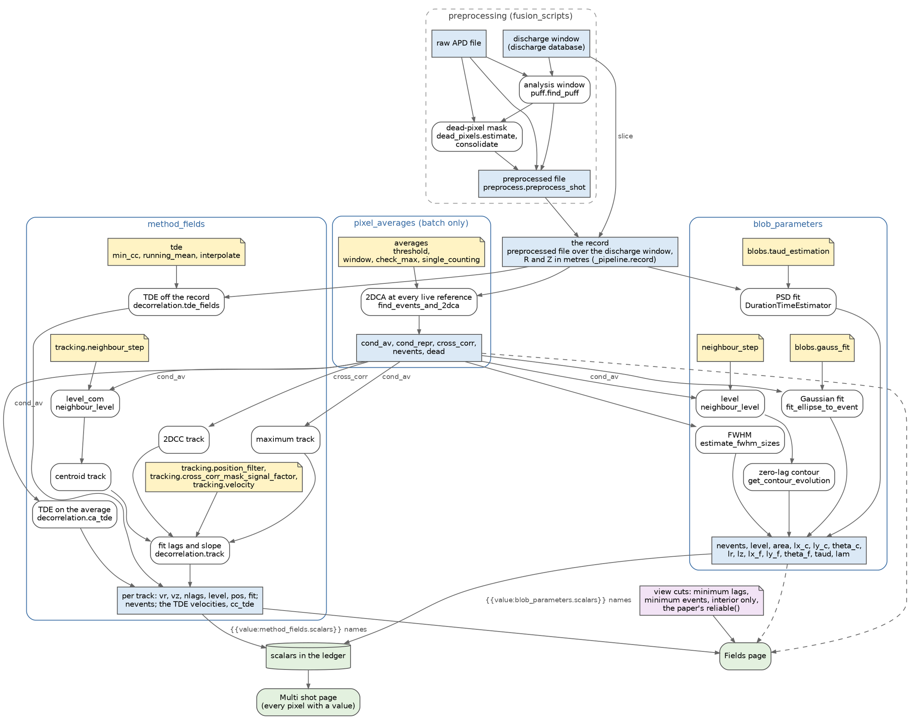

<!--
The text of the Documentation page (fusion_ui/pages/6_documentation.py). The page reads this file at every
rerun, so an edit shows on the next one, with no restart. Reword freely; keep the markers below.

- A `## ` heading starts a section of the page. `### ` and deeper are headings inside it.
- {{value:NAME}} inside a sentence is a number read from the code and {{default:PATH}} the default of a
  product's setting, so that the text cannot drift from what runs (fusion_ui/documentation.py: facts,
  defaults). A name the code does not know shows as written and is flagged on the page; a test fails on it.
- A line holding only {{table:settings}} or {{table:scalars}} is a table generated from the code.
- A `### ` heading made only of scalar names in backticks is the entry of those names, which the scalar
  table links to. Every scalar name a spec writes has exactly one entry, and a test checks it.
- The fenced `dot` block is the dependency diagram, drawn by Graphviz.
- Every account of a computation names the code it describes, as `file: function`. Where the code and a
  docstring or the paper disagree, the text says what the code does.

The accounts of the computations were last read in full against fusion_scripts 9e14f01, imaging-methods
5816550, velocity-estimation b3b6945, experimental_database 9140930 and fpp-analysis-tools 6f98750. Update
this line when the text is read against the code again.
-->

What each quantity in Shot Explorer is, how it is computed, and what it depends on. Each account names the
code it describes, as `file: function`; where a docstring or the paper says otherwise, it follows the code.
The defaults and constants quoted, and the tables of settings and of scalar names, are read from the code.
The text is `fusion_ui/data/documentation.md`, and can be reworded there.

## Conventions

- **R and Z.** R is the major radius and Z the vertical position. *Radial* means along R, *poloidal* along Z.
- **Pixels.** A pixel is named by its column x and row y in the array, counted from 0: "pixel (5, 4)" is
  column 5, row 4. In the C-Mod APD files x grows with R and y with Z, so a row of the array runs radially and
  a column poloidally. In the names `vx_tde` and `vy_tde`, x means R and y means Z.
- **Units.** SI throughout: m, s, m/s, m². The APD files hold R and Z in centimetres. The three products
  convert them to metres as they read the record (`fusion_ui/plots/_pipeline.py: record`), so their
  velocities come out in m/s; `velocity_tde` computes in centimetres and divides its result by 100. Lags are
  stored in seconds; the Fields page shows them in µs.
- **Lags and signs.** The lag τ is the time since an event peaked at the reference pixel. The conditional
  average at τ is the frame τ after each peak, averaged over the events, and the cross-correlation at τ pairs
  every pixel at time t + τ with the reference at t (`imaging_methods/cond_av.py: find_events_and_2dca`). A
  structure moving outward is therefore at larger R at positive lags. v_R is positive outward, towards larger
  R, and v_Z positive upward, towards larger Z.
- **Amplitudes.** The preprocessed record is in units of each pixel's running standard deviation (next
  section). The 2DCA threshold and the amplitude of a conditional average are in those units.

## From the raw file to the record

### The preprocessed file

The raw file `apd_<shot>.nc` holds the digitizer's voltage at every pixel, `frames` (y, x, time), and each
pixel's R and Z. The products read the preprocessed file, `apd_<shot>_preprocessed.nc`, which fusion_scripts
makes from the raw file (`density_scan/preprocess.py: preprocess_shot`). The methods it calls, the dead-pixel
estimate and the puff window, are in imaging_methods, as is every analysis below:

1. **Running normalisation** (`experimental_database/preprocessing.py: run_norm_ds`, through
   `fppanalysis.run_norm`). Each pixel's series has its running mean subtracted and is divided by its running
   standard deviation, both over {{value:preprocess.window}} samples, about 1 ms at the APD's 0.5 µs
   sampling. Fluctuations slower than that are taken out. The first and last {{value:preprocess.trimmed}}
   samples of the record have no complete window and are dropped. A sample that comes out not finite is set
   to 0.
2. **Dead pixels** (`experimental_database/preprocessing.py: interpolate_nans_3d`). Each pixel of the run
   day's mask (below) is replaced, sample by sample, by linear interpolation between the live pixels around
   it on the grid of pixel indices. A dead pixel outside the live pixels' hull takes its nearest live pixel's
   value.
3. The frames are stored as float32 and cut to the discharge window.
4. The result is cut again, to the analysis window (below). The normalisation in step 1 ran before this cut,
   so it saw the same neighbouring samples as without it.

Steps 1 to 3 are `PlasmaDischargeManager.preprocess_dataset` (`experimental_database/discharge_manager.py`);
step 4 is `preprocess_shot`'s own.

Beside the frames the file keeps the mask it was made with (`dead`), the shot's own verdict before the run
day's rule (`dead_shot`), the evidence for it (`dead_evidence`, `dead_psd_ratio`), and attributes saying
how and when: `dead_mask_source`, `analysis_window`, `discharge_window`, `puff_rule`, `dead_thresholds`,
`preprocess_radius`, `fusion_scripts_commit` and `created`.

**The nine 1160616 files** were made another way, by `density_scan/data_processing.py: preprocess_data`:
the frames in float64, with the hand-made 1160616 mask (`experimental_database.hand_made_dead_pixel_mask`),
over the discharge window and with no cut to the puff. They store no mask, and the analyses use the
hand-made one for them (`imaging_methods.decorrelation.dead_mask`, given the table of
`experimental_database`). Any other file that stores no mask is refused: it may have been made with another
run day's mask, and must be preprocessed again.

### The analysis window

The discharge window, `t_start..t_end` in the discharge database, often starts before the gas puff, while
the live pixels still read the dark level; on many shots it is the whole record. That dark stretch distorts
every statistic taken over the window. `imaging_methods.puff.find_puff` cuts the window to the puff:

1. The signal is the mean over the pixels of the raw frames, smoothed by a running mean over
   {{value:puff.smooth}}.
2. The *dark level* is the median of the signal's first {{value:puff.baseline}}, and the *light level* its
   median over the discharge window. The threshold is halfway between them. Which side of the dark level the
   light is on is read off the data, as the side of the window's largest excursion; on C-Mod more light reads
   higher.
3. When the median is less than {{value:puff.clear_rise}} of the way from the dark level to that excursion,
   most of the window is dark after a short puff. The window's {{value:puff.fallback}} is then the light
   level, provided that at this level the rise is clear and the start of the record flat (step 5).
4. The puff runs from the first point at which the signal crosses the threshold and stays across it for at
   least {{value:puff.min_on}}, to the last point of the last such stretch. The **analysis window** is the
   overlap of the puff with the discharge window. A dip below the threshold inside it, as between two puffs,
   is reported in `puff_rule` and not cut. A cut shorter than {{value:puff.smooth}} is not made.
5. The discharge window is kept whole, and `puff_rule` says why, when the record does not start dark (its
   first {{value:puff.baseline}} vary by more than {{value:puff.flat_start}} of the rise from the dark to the
   light level), when there is no clear rise, when the signal never stays across the threshold for
   {{value:puff.min_on}}, or when the puff overlaps the window by less than {{value:puff.min_span}}.

**What the analyses read.** Shot Explorer slices every record to the discharge window as the discharge
database gives it now (`fusion_ui/core/loader.py: time_window`; a shot without one is read over a centred
{{value:loader.default_window}}). A file cut to the analysis window lies inside it, so the analyses read the
analysis window; the nine 1160616 files are read over their discharge window.

The window a result was computed over is not stored with the result. If the discharge database's window is
edited later, the stored result and a recompute disagree, and nothing marks the stored one stale.

### Dead pixels

A pixel is *dead* when its channel carries no plasma signal. `imaging_methods.dead_pixels.estimate` judges
every pixel of a raw file over the shot's analysis window:

1. **Red spectrum.** The pixel's Welch power spectrum gives a ratio: its median over {{value:dead.red_band}}
   divided by its median over {{value:dead.noise_band}}, where only digitizer noise is left. Noise is white,
   a ratio near 1, and plasma fluctuations are stronger at low frequency. A ratio above {{value:dead.red}}
   makes the pixel live.
2. **Following a live neighbour.** A pixel that fails step 1 is still live when its {{value:dead.blob_band}}
   signal follows an already-live pixel among its eight neighbours: the regression gain of its band-passed
   signal on the neighbour's, their correlation times the ratio of their standard deviations, exceeds
   {{value:dead.gain}}. This repeats until no pixel joins. It keeps dim pixels whose own fluctuations are
   weak.
3. Every other pixel is dead, and so is a pixel whose samples are not all finite or do not vary.

The run day's mask (`imaging_methods.dead_pixels.consolidate`) marks a pixel dead on every shot of the day
when it is dead on at least {{value:dead.day_fraction}} of them, since the hardware does not change within a
day. Run day 1160616 uses the hand-made mask instead, which this estimate reproduces.

The dead-pixel view of the Single shot page, on the raw file, draws every pixel's PDF and spectrum against
the shot's verdict, and the array-mean signal with the discharge and analysis windows marked. It carries the
method in full.

**What the analyses do with a dead pixel.**

- `pixel_averages` never takes it as the reference (`computed` is False there). `method_fields` and
  `blob_parameters` are NaN there and write no scalar for it. Both take the mask from the bank, with its
  source (`dead`, `dead_mask_source`), and never compute it again.
- It still appears in every frame, with the value preprocessing interpolated. The conditional averages,
  contours and maximum tracks pass over it smoothly; it adds nothing of its own.
- Neither TDE uses it as a neighbour.
- The Fields page marks it as dead (a grey square), apart from a live pixel whose method failed (a red
  cross).

### The record the products read

`pixel_averages`, `method_fields` and `blob_parameters` read preprocessed files only. Each takes the file
sliced to the discharge window, with R and Z in metres and the whole record loaded into memory
(`fusion_ui/plots/_pipeline.py: record`, which refuses an R that is not a major radius in centimetres). The
physics is `imaging_methods.decorrelation`, which the paper's own runs call too, so the app and the paper
read the same numbers.

## How the quantities depend on one another

Each arrow runs from an input to what is computed from it. Blue boxes are data, white boxes computations,
yellow notes settings, and the green boxes are where results are read.

## The products

Three results per shot, written to netCDF in the result store. The Fields page reads them, and the Multi
shot page reads the scalars they write. Their variable names are those of the paper's own files, so the
paper's code could read them as they are.

| product | what it is | read from | computed | cost a shot | scalars |
|---|---|---|---|---|---|
| `pixel_averages` | the conditional average at every pixel | the record | in batch only, by `fusion-ui precompute` | 35–70 min on one core | none |
| `method_fields` | the velocity fields of every method | `pixel_averages` and the record | by `fusion-ui precompute`, or on the Single shot page once its bank is stored | 1–3 min | {{value:method_fields.scalars}} per live pixel |
| `blob_parameters` | the blob parameters at every pixel | `pixel_averages` and the record | by `fusion-ui precompute`, or on the Single shot page once its bank is stored | about a minute | {{value:blob_parameters.scalars}} per live pixel |

### pixel_averages

For each live pixel in turn as the reference, `imaging_methods.decorrelation.average` runs the
two-dimensional conditional average (2DCA), `imaging_methods/cond_av.py: find_events_and_2dca`, on the
record:

1. **Events.** An event is a run of consecutive samples in which the reference's signal exceeds
   `averages.threshold`. Its peak is the run's largest sample.
2. An event is dropped unless, at its peak, the reference is the largest pixel of the square
   `averages.check_max` pixels around it, cut at the array's border; 0 turns this off.
3. An event too near the start or end of the record for a whole window is dropped.
4. With `averages.single_counting`, events are taken highest peak first, and one that peaks less than a
   window from an event already taken is dropped.
5. Each event contributes the frames around its peak: `averages.window` samples, widened by one when even,
   so that a window of n samples gives the lags −⌊n/2⌋ to +⌊n/2⌋ samples.

The bank stores, for every reference, at every pixel and lag:

- `cond_av`, the **conditional average**: the mean over the events of the frame at each lag;
- `cond_repr`, the **conditional representativeness**: `cond_av`² divided by the mean over the events of
  the squared frame. It is 1 where every event has the same value, and smaller as they scatter;
- `cross_corr`, the **cross-correlation** of each pixel with the reference over the whole record, not over
  the events: both series standardised over the record, multiplied, summed and divided by the number of
  samples, at the same lags as the average.

Per reference it stores `nevents`, the number of events kept (0 for a live reference without any, whose
average is all NaN), and `computed`, False at dead references; and the mask, `dead`. The settings are
stamped in the attribute `averages`.

The bank is the expensive step: for every reference, `find_events_and_2dca` correlates every pixel with the
reference over the whole record. That is why it is computed once per shot and settings, in batch, and
everything else reads it back.

### method_fields

`imaging_methods.decorrelation.fields` reads seven velocities at every live pixel: three 2DCA tracks through
the pixel's own conditional average, and three- and two-point time-delay estimation (TDE) twice, off the
record and on the average. A pixel without events has no tracks and no TDE on the average; the TDE off the
record needs no events.

**The three tracks** (`imaging_methods.decorrelation.TRACKS`) follow the structure through the reference's
average lag by lag, and fit a velocity to its path.

| suffix | field | position at each lag |
|---|---|---|
| `max` | `cond_av` | its maximum, refined to a fraction of a pixel |
| `com` | `cond_av` | the centroid of its contour at the level `level_com` |
| `2dcc` | `cross_corr` | its maximum, refined to a fraction of a pixel |

- **Maximum** (`imaging_methods/maximum_trajectory.py: compute_maximum_trajectory_da`). The brightest pixel
  of the frame. Away from the array's border, a parabola through it and its two neighbours moves the
  position by at most half a pixel, along the row and along the column separately, and only in a direction
  in which the brightest pixel exceeds both its neighbours. R and Z are interpolated linearly at the result.
  On the border the brightest pixel's own position is kept. A frame whose largest value is negative takes the
  position of the nearest lag that has one.
- **Centroid** (`imaging_methods/contours.py: get_contour_evolution`). The contour of `cond_av` at
  `level_com` times the largest value of `cond_av` over all lags and pixels: one absolute level for every
  lag, so the contour shrinks as the average decays and is gone once the average is below it. At each lag
  the contour is found by marching squares (`skimage.measure.find_contours`). Of several, the one enclosing
  the most signal is kept, the sum of `cond_av` at the pixels inside it (`compute_contour_mass`). The
  position is the centroid of the area the contour encloses: the geometric centre of the polygon, not
  weighted by the average's values. A contour cut by the array's border is closed by a straight line between
  its ends.
- **The contour level** (`imaging_methods/contours.py: neighbour_level`) is read off the pixel's own
  average, not set. In the frame at lag 0, take the brightest pixel and its four neighbours
  `tracking.neighbour_step` pixels away along the row and the column, fewer on the border. The level is the
  mean of the neighbours' values divided by the brightest pixel's. The contour at lag 0 therefore reaches, on
  average, one step out from the peak. The brightest pixel is normally the reference: `check_max` makes the
  reference the largest of its neighbourhood in every event.

**The fit** (`imaging_methods.decorrelation.track`, through
`imaging_methods/velocity_estimates.py: get_combined_mask` and `get_averaged_velocity_from_position`):

1. A lag at which the tracker found no position is filled by linear interpolation between the lags around
   it, extrapolated at the ends, and the track is smoothed over `tracking.position_filter.window_size` lags with
   a `tracking.position_filter.window_type` window (`imaging_methods/utils.py: smooth_da`). A window of 1
   leaves the track as it is.
2. The slope rests on the lags at which the position is within `tracking.position_filter.mask_distance`
   pixel pitches of the reference pixel (the mean pitch along R) and the field's largest value exceeds
   `tracking.position_filter.mask_signal_factor` times its largest value over all lags. For the 2DCC
   `tracking.cross_corr_mask_signal_factor` replaces the latter, because the cross-correlation sits on a
   pedestal well above zero. With `tracking.position_filter.require_within_boundaries` on, the centroid track
   also needs a contour that closes inside the array. Of the lags that pass, only the longest run of
   consecutive ones is kept, the earlier of two equally long.
3. The velocity is the slope of R and of Z against the lag over those lags: the least-squares slope when
   `tracking.velocity.estimator` is `lsq`, the mean of the centred differences when it is `central_diff`.
   It is NaN when no lag passes, and with `lsq` when fewer than two of them have a position.

For each track T the product stores `vr_T` and `vz_T`, `nlags_T` (the number of lags the slope rests on),
`level_T` (the contour level; NaN for the two maximum tracks), `pos_r_T` and `pos_z_T` (the position at every
lag, NaN where the tracker found nothing) and `fit_T` (true at the lags the slope rests on). A lag filled in
step 1 can be in `fit_T`, and counted in `nlags_T`, with no position.

**TDE off the record** (`imaging_methods.decorrelation.tde_fields`, with `velocity_estimation`'s
cross-correlation method, `TDEMethod.CC`). The delay from a pixel to a neighbour is the lag at which the
cross-correlation of the neighbour's series with the pixel's, over the whole record, peaks
(`velocity_estimation/time_delay_estimation.py: estimate_time_delay_ccf`):

- the cross-correlation is normalised, and its peak searched within 100 samples of zero lag;
- a peak below `tde.min_cc` gives no delay;
- with `tde.running_mean`, a cross-correlation with more than one local maximum above half the largest is
  smoothed by running means of 3, 5 and then 7 samples until it has one; if 7 do not do it, or it has no
  local maximum, there is no delay;
- with `tde.interpolate`, the delay is the maximum of a quartic spline through the cross-correlation rather
  than the sample at its peak.

The neighbours are the pixels on either side along the row and along the column, where they are on the
array and live. Each pair of one row neighbour and one column neighbour gives a velocity: four pairs inside the
array, two on an edge, one in a corner. The pixel's velocity is the mean over the pairs that gave one
(`velocity_estimation/two_dim_velocity_estimates.py: estimate_velocities_for_pixel`):

- **three-point** (`vr3_tde`, `vz3_tde`; `get_2d_velocities_from_time_delays`): the delays to the row
  neighbour (τ_r) and to the column neighbour (τ_z) are solved together for the velocity of one structure
  crossing the three pixels. On a rectangular grid with pitches Δr and Δz this reads
  v_R = Δr τ_r / (τ_r² + (Δr/Δz)² τ_z²) and v_Z = Δz τ_z / ((Δz/Δr)² τ_r² + τ_z²); the code uses the
  pixels' actual positions;
- **two-point** (`vr2_tde`, `vz2_tde`; `get_1d_velocities_from_time_delays`): each component on its own,
  v_R = Δr/τ_r and v_Z = Δz/τ_z, and 0 where a delay is exactly 0.

`cc_tde` is the mean, over the pairs used, of the smaller of the two cross-correlation peaks of a pair.

**TDE on the conditional average** (`imaging_methods.decorrelation.ca_tde`). The same two estimates, with each
delay read off the pixel's own `cond_av` instead of off the record: the lag at which `cond_av` peaks at the
pixel and at each live neighbour, the maximum of a quartic spline through the lags
(`imaging_methods/maximum_trajectory.py: get_maximum_time`). The delay along the row is the mean of
t(x+1) − t(x) and t(x) − t(x−1), over the neighbours there are; the delay along the column likewise. The
pitches are read off the array's first pixels. The two-point estimate is NaN, not 0, for a delay of exactly 0.

### blob_parameters

`imaging_methods.decorrelation.blobs` (`pixel_blob` at each pixel) describes the structure behind every live
pixel's conditional average, from the average at lag 0 and from the pixel's series in the record. The app
shows six of its numbers:

- `nevents`, the events behind the average, which `method_fields` writes as the scalar `number_events`;
- `area`, the area inside the contour of `cond_av` at lag 0, at a level read off the average;
- `lr`, `lz`, the full widths at half maximum along the reference's row and column;
- `taud`, `lam`, the duration time and asymmetry of the pulses, fitted to the power spectrum of the pixel's
  series. They are written as the scalars `taud_psd` and `lambda_psd`.

Each is NaN where its estimate fails. The entries under *Every scalar name* say how each is computed.

The blob holds seven more variables, which the app neither shows nor writes as scalars: `level`, the contour
level behind `area`; `lx_c`, `ly_c` and `theta_c`, an ellipse fitted to that contour; and `lx_f`, `ly_f` and
`theta_f`, a tilted Gaussian fitted to `cond_av` at lag 0, which the settings under `blobs.gauss_fit` belong
to.

## The settings

A setting is a parameter of a product, and part of its cache key. Changing one gives new results beside the
old ones and never overwrites a result. A change to `averages` gives a new bank, and with it new
`method_fields` and `blob_parameters`; a change to anything else gives new results for one product,
computed in minutes from the bank already stored.

{{table:settings}}

The defaults are the C-Mod settings of the paper's twodca deck, written out in
`imaging_methods/decorrelation.py` (`Averages`, `Tracking`, `Tde`, `Blobs`), the same for every shot. A shot
they do not suit shows up as failed pixels; it is not retuned.

To compute with other settings, name the part that changes in a JSON file, such as
`{"averages": {"window": 30}}`, and run `fusion-ui precompute method_fields blob_parameters --shot N
--params-json params.json`. The Single shot page computes `method_fields` and `blob_parameters` with other
settings itself once their bank is stored. The Fields page offers every `method_fields` parameter set the
ledger has.

**Not settings.** The contour level is read off each pixel's average, and only `neighbour_step` is set. The
reference pixel is every live pixel in turn. The Fields page's cuts are view state: moving them recomputes
nothing.

## Every scalar name

A scalar is one number per pixel, or one per shot, kept in the ledger; the Multi shot page plots it across
shots. A name can be written by several sources, each with its own settings, and the Multi shot page lists
the sources apart. Its mean, median and maximum over pixels take every pixel that has a value: the Fields
page's cuts do not apply there. In the products a dead pixel has no row, and a live pixel whose estimate
failed has an empty value, which means tried and failed.

{{table:scalars}}

### `vr_max`, `vz_max`, `nlags_max`

The 2DCA maximum track: the slope of the position of the maximum of the pixel's own `cond_av` against the
lag, in R and in Z, and the number of lags the slope rests on (*method_fields* above). The maximum moves by
whole pixels, refined by at most half a pixel. Where a structure passes close to the centre of the
reference pixel, the maximum can stay on that pixel for several lags, and the slope then reads low. The
paper's figures and its `reliable()` cut use the centroid track for this reason
(`imaging_methods.decorrelation.TRACK`).

### `vr_com`, `vz_com`, `nlags_com`, `level_com`

The 2DCA centroid track: the slope of the centroid of the contour of `cond_av` against the lag, in R and in
Z, the number of lags the slope rests on, and the level of the contour.

`level_com` is **not a setting**. It is read off the pixel's own average before tracking (*The contour
level* under *method_fields* above). Only `tracking.neighbour_step` is set
({{default:tracking.neighbour_step}} by default).

- The centroid is the centre of the area inside the contour, not weighted by the average. A contour cut by
  the array's border is closed by a straight line, and its centroid then follows the border rather than the
  structure. `tracking.position_filter.require_within_boundaries` drops such lags from the fit, and is off by
  default.
- `nlags_com` counts the lags at which the contour was lost and the position interpolated, as the paper
  does; `fit_com` includes them, and `pos_r_com`, `pos_z_com` are NaN there.

### `vr_2dcc`, `vz_2dcc`, `nlags_2dcc`

The 2DCC track: the slope of the maximum of the pixel's `cross_corr`, found as for the 2DCA maximum, and the
lags it rests on. The cross-correlation is taken over the whole record, not over the events, so it does not
depend on `averages.threshold`, `averages.check_max` or `averages.single_counting`; `averages.window` sets
the lags it spans. A pixel without events has no 2DCC all the same, since the bank keeps nothing for it.
Its fit uses `tracking.cross_corr_mask_signal_factor`
({{default:tracking.cross_corr_mask_signal_factor}} by default): the cross-correlation sits on a pedestal
well above zero, where a fraction chosen for the decaying average would never bind. The Fields page does not
cut it by events, and colours its arrows by the pixel's events all the same.

### `number_events`

The number of events in the pixel's conditional average, those the rules under *pixel_averages* keep:
`nevents` in all three products, written once, by `method_fields`. Every setting under `averages` changes
it.

### `vr3_tde`, `vz3_tde`, `vr2_tde`, `vz2_tde`, `cc_tde`

TDE off the record: v_R and v_Z by three-point and by two-point time-delay estimation, from the
cross-correlations of the pixel's series with its neighbours' over the whole record (*method_fields* above),
and the cross-correlation peak they rest on.

- It conditions on nothing. Every fluctuation in the record counts, where the tracks of the conditional
  average follow only the events.
- The two-point estimate divides a pitch by a delay, so a component whose delay is near zero is very large,
  and at a delay of exactly 0 it is set to 0. The three-point estimate solves both delays together and stays
  finite; it is NaN at the whole pixel when any neighbour pair has both delays 0.
- `cc_tde` is read after the running mean. A pair whose peak is below `tde.min_cc`
  ({{default:tde.min_cc}} by default) gives no delay, and does not count.
- On the array's edge fewer pairs are averaged, and a dead neighbour is not used.
- These are not `vx_tde`, `vy_tde`, which take their delays from a conditional average instead (below).

### `vr3_catde`, `vz3_catde`, `vr2_catde`, `vz2_catde`

TDE on the conditional average: the same three- and two-point estimates, with each delay read off the
pixel's own `cond_av`, as the lag at which it peaks at the pixel and at its live neighbours (*method_fields*
above). The average is the 2DCA tracks' own, so a difference from them comes from how the average is read,
not from which events went into it.

### `area`

The area enclosed by a contour of `cond_av` at lag 0 (`imaging_methods/contours.py: get_contour_evolution`):
the area of the polygon, in m².

- **The level of the contour is not a setting.** It is read off the pixel's own average by the rule of
  `level_com` (`imaging_methods/contours.py: neighbour_level`): the mean value of the four pixels
  `neighbour_step` from the peak of the frame at lag 0, as a fraction of the peak. Only `blob_parameters`'
  own `neighbour_step` is set ({{default:neighbour_step}} by default). The contour is drawn at that fraction
  of the largest value of `cond_av` over all lags. The blob keeps the fraction as `level`; it equals
  `level_com` while both products use the same neighbour step, as they do at the defaults.
- Of several contours, the one enclosing the most signal is kept.
- A contour cut by the array's border is closed by a straight line, so a structure larger than the view has
  the area of its part inside the view.

### `lr`, `lz`

The full width at half maximum of `cond_av` at lag 0, `lr` along the reference's row (R) and `lz` along its
column (Z): the distance between the half-maximum points on the two sides of the reference
(`imaging_methods/parameter_estimation.py: estimate_fwhm_sizes`). The half maximum is half the reference
pixel's own value. On each side the profile is followed outward from the reference for as long as it does
not rise, and the half point is interpolated linearly along that falling stretch.

**The interpolation leaves out the last point of the falling stretch.** A side whose profile has not fallen
to half by the second-to-last point is held at that point, so its width is underestimated, and a side that
falls for a single pixel and then rises counts as 0. A side that rises at once is NaN.

### `taud_psd`, `lambda_psd`

The duration time τ_d and the asymmetry λ of the pulses, from a fit to the power spectrum of the pixel's own
series over the whole record (`imaging_methods/duration_time_estimation.py:
DurationTimeEstimator.estimate_duration_time`; `blob_parameters` stores them as `taud` and `lam`):

1. The series is standardised and its Welch spectrum taken in segments of `blobs.taud_estimation.nperseg`
   samples. The zero frequency is dropped, and the frequencies are converted to angular frequency ω and kept
   below `blobs.taud_estimation.cutoff` rad/s.
2. The spectrum is fitted with that of a train of two-sided exponential pulses,
   S(ω) = 4τ_d / ([1 + ((1 − λ)τ_dω)²][1 + (λτ_dω)²]) (`imaging_methods/utils.py: power_spectral_density`),
   by least squares on its values rather than their logarithms, with differential evolution from a fixed
   seed. A pulse rises over λτ_d and decays over (1 − λ)τ_d.

- **λ and 1 − λ give the same spectrum**, so the fit cannot tell a fast rise from a fast decay. Read λ and
  1 − λ as the same answer.
- The whole record counts, not only the events, and the value is written even at a pixel without events.
- The running normalisation of preprocessing takes out fluctuations slower than its window of
  {{value:preprocess.window}} samples, and the fit cannot see them.
- The `taud_psd` spec of the Single shot page runs the same fit, with the same defaults, at one pixel. It
  also runs on raw files, which are not normalised; the Multi shot page lists those results as a source of
  their own.

### `vx_tde`, `vy_tde`

`velocity_tde` (`fusion_ui/plots/velocity_tde.py: compute`), the estimator of the velocities in Garcia,
Losada et al., PPCF 68 (2026) 055034: v_R and v_Z by three-point TDE at one pixel, with each delay read off
a cross-conditional average (`velocity_estimation`'s `TDEMethod.CA`): the neighbour's series averaged around
the peaks at which the pixel's own exceeds {{value:velocity_tde.min_threshold}}, in the record's units. A
neighbour is used only where its cross-correlation with the pixel peaks at least
{{value:velocity_tde.ccf_min_lag}} sample from zero lag, and the hand-made 1160616 mask marks the dead ones,
on every shot. These are not `vr3_tde`, `vz3_tde`, which take their delays from the cross-correlation.

### `dead`, `psd_ratio`, `number_dead`

`dead_pixels` (`fusion_ui/plots/dead_pixels.py: scalars`), on a raw file: at each pixel, 1 where the shot's
own verdict is dead and 0 where it is live, and the ratio of the red-spectrum test (NaN where the pixel has
no data); per shot, the number of dead pixels. They are the shot's verdict before the run day's rule (*Dead
pixels* above). The mask a preprocessed file was made with is in the file, not in the ledger.

### Rows under `density_scan_import`

A ledger that imported the density scan's `results.json` holds its rows under the plot key
`density_scan_import` (`fusion_ui/core/seed.py`), and the Multi shot page lists them as a source of their
own. They were computed by fusion_scripts (`density_scan/utils.py: analysis`) with that scan's settings, at
a 2DCA threshold of 2. Seven of the names have an entry above: `number_events`, `lr`, `lz`, `taud_psd`,
`lambda_psd`, `vx_tde` and `vy_tde`. Five have none, since nothing in the app computes them: `vx_c`, `vy_c`
and `area_c`, the velocity of the centroid and the area of a contour at a fixed fraction of the average's
maximum, and `vx_2dca_tde` and `vy_2dca_tde`, a three-point TDE on the conditional average. The app has no
command that imports them; `fusion-ui prune --plot density_scan_import` counts the rows, and deletes them
with `--yes`.

## The Fields page's cuts

The Fields page draws every method's field for one shot from the stored products and computes nothing. Its
cuts choose which pixels the panels draw as arrows. They are view state, not settings: moving one recomputes
nothing and changes no stored number.

- **Minimum lags** ({{value:cuts.min_lags}} by default) applies to the three 2DCA tracks. A slope through
  two or three lags is a secant, not a fit.
- **Minimum events** ({{value:cuts.min_events}} by default) applies to the methods read off the conditional
  average: the 2DCA maximum and centroid, and the TDEs on it. The 2DCC and the TDEs off the record do not
  depend on the events.
- **Interior pixels only** ({{value:cuts.interior_only}} by default) leaves the array's border out of every
  panel.
- **The paper's cut, reliable()** ({{value:cuts.paper}} by default), replaces the three above and keeps the
  same pixels in every panel: those whose centroid track rests on at least the minimum of lags and events,
  whose centroid and both TDEs off the record gave a velocity, and which are not on the border
  (`fusion_ui/views/reliable.py: rule`, which a test holds equal to
  `imaging_methods.decorrelation.reliable`).

A pixel the cuts leave out keeps its value in the product and in the ledger, and the Multi shot page's means
include it. All seven panels share one arrow scale, set by the three 2DCA tracks. The arrows of the TDEs off
the record are coloured by `cc_tde`, and all others by the pixel's events.

## Thomson scattering profiles

The Single shot page draws the Thomson scattering (TS) profiles of a shot from `thomson_scattering_<shot>.nc`
(`fusion_ui/plots/thomson_profiles.py: figure`). Nothing is fitted in the app: the file holds the measurements
and the fit, and the page draws them, working out only the p_e of the points
(`fusion_ui/plots/thomson_profiles.py: Points.pe`), where the points go when the fit was moved
(`fusion_ui/plots/thomson_profiles.py: Points.on`) and where the separatrix is
(`fusion_ui/plots/thomson_profiles.py: separatrix`). fusion_scripts makes the file on mfe, where the tree and the
fitting code are (`tools/mfe/get_thomson_scattering.py: make`), with C-Mod_Analysis 24e1499, GitHub's head, and its
own settings. A file made with mfe's d6a6466 is drawn too; the end of "What is fitted" says how the two differ. This
section was read against that script at fusion_scripts `721c1ad`, and against what it says of C-Mod_Analysis
`24e1499` and `d6a6466`.

### What is measured

Two systems, the edge and the core, read n_e and T_e at each of their channels (`edge_Z`, `core_Z`) at every laser
pulse, 10 to 20 ms apart. The file keeps each system's values as the tree has them over the whole shot, with the
tree's 1σ errors: `edge_ne`, `edge_ne_err`, `edge_Te`, `edge_Te_err`, and the same for the core. Pulses of the
two systems within 1 ms of each other share one entry of `time`, at the edge's stamp
(`tools/mfe/get_thomson_scattering.py: align_pulses`).

**A 0 is no measurement.** n_e and T_e are almost always 0 together, and the errors there mean nothing, so the
page draws only the points with n_e > 0, and a point whose error is missing or not positive without a bar. The
file holds no p_e of the measurements: the page draws e·n_e·T_e at each point, with the two errors in quadrature.

### What each axis means

Each point has a ρ_pol and an R_mid for its own pulse, from the EFIT tree the attribute `efit_tree` names, at the
EFIT time nearest the pulse (`tools/mfe/get_thomson_scattering.py: map_channels`): ANALYSIS, which C-Mod_Analysis
24e1499 always maps the points of its fit with, or, in a file made with d6a6466, EFIT20, or ANALYSIS where EFIT20
has none. A pulse outside that tree's time base has neither, and the page leaves its points out and says how many.
Where mapping the points failed, the file says so in `mapping_failure`, a sentence beginning "mapping failed:" that
names the system, the coordinate, the pulses and the error; those points have no ρ_pol or R_mid there, and the page
leaves them out as well and quotes it where it counts them.

- **ρ_pol** is √ψ_N, the normalised poloidal flux coordinate: 0 on the magnetic axis and 1 at the separatrix.
- **R_mid** is the major radius at which the point's flux surface crosses the outboard midplane, in metres. It is
  not where the channel looks: `edge_R` and `edge_Z` say that. The fit and the separatrix are at the window's
  middle time, but each point is at its own pulse, so a plasma that moves within the window shows as scatter
  against them. The separatrix on this axis is `R_mid_sep`, or the fit's R_mid at ρ_pol = 1 where the file has
  no scalar.

**Where the fit was moved to a separatrix, the points are drawn moved with it**
(`fusion_ui/plots/thomson_profiles.py: Points.on`). Such a fit lies on an axis of its own, `fit_rho_shift` away
from EFIT's (see "What is fitted"), and the points, drawn where EFIT puts them, would sit beside it by that much.
So each point is drawn where the fit saw it: on ρ_pol at its own ρ_pol plus `fit_rho_shift`, and on R_mid at the
fit's own R_mid of that ρ_pol (`fit_R_mid`, interpolated), which is at the window's middle time rather than at the
point's own pulse. The separatrix is the fit's ρ_pol = 1, and on R_mid the fit's R_mid there, where the fit's T_e
is the T_e it was moved to. A caption under the figure gives the move, each point's hover gives where EFIT puts it
as well, and each row's range is set by the points as they are drawn.

**Whether the fit saw these points** is in `fit_points_check`, which compares the edge points the fit was made on
with the file's own, moved by any `fit_rho_shift`: `equal`, or a sentence beginning "differ:" that says by how much.
Anything but `equal` gets a warning above the figure that quotes it, since the points drawn may then not be where
the fit saw them (`fusion_ui/plots/thomson_profiles.py: points_warning`). A file without the attribute gets no
warning.

### What is fitted

`tools/mfe/get_thomson_scattering.py: fit_profiles` calls `cmod_tools.py: get_cmod_kin_profs` of C-Mod_Analysis
with the settings of that repository's `run_db.py`, which the file keeps as `fit_settings`. It fits Osborne mtanh
profiles to the edge and core points of the discharge window together: **one profile for the whole window**, not
one per pulse, on a grid of 1000 values of ρ_pol from 0 to 1.1 (moved with the fit where the fit was moved, below),
with R_mid on it. The window is the discharge DB's, in `window_t_start` and `window_t_end`: the legend gives it, and
the caption says when the page's window is another. A shot whose fit failed has no fit and says why in
`fit_status`; every shot with core TS only reads "No edge Thomson data!". Of the 116 files made with 24e1499, 95
hold a fit: 12 have core TS only, and nine lost the fit to an error that `fit_status` quotes (arrays of different
lengths on seven, an interpolation above the range of its data on two) and that mfe's log of 2026-10-12 puts in
24e1499's own code. Of the 115 made with d6a6466, 103 do: the same 12 have none, and the nine were fitted. The page
draws the fit over its whole range, with no band. Each row's range is set by the
points and not by the fit (`fusion_ui/plots/thomson_profiles.py: y_limits`, the rule of the density scan's PDF): it
runs from 0 to {{value:thomson.margin}} times the larger of the {{value:thomson.percentile}} of the points measured
to better than {{value:thomson.sigmas}}σ (all of them where fewer than {{value:thomson.min_well}} are) and the fit's
largest value where it stays within {{value:thomson.fit_factor}} times the median of the {{value:thomson.nearest}}
points nearest it on the axis drawn, so a fit that runs away leaves through the top instead of squashing the points
against zero, the points above the top are counted in the row's corner, and autoscale returns to this range.

At 24e1499, `run_db.py` gives the fit two settings d6a6466's did not, and they change what the file holds:

- **Fictitious points beyond the separatrix** (`force_to_zero`). Before each fit, `get_cmod_kin_profs` adds a T_e
  point of 5 eV at ρ_pol 1.05 and an n_e point of 0.1·10²⁰ m⁻³ at 1.1, with errors of 1 eV and 10¹⁷ m⁻³, as the
  file's `fit_note` says. They hold the outer side of the n_e and T_e fits, which therefore say nothing measured
  there, and the page says so under the figure. They do not hold the p_e fit.
- **The separatrix from the fit's own T_e** (`lambdaq_type` 'profile', `sub_type` 'log_linear'), which d6a6466
  neither looked for nor moved its fit to. `power_balance.py: find_separatrix` looks for the separatrix T_e in the
  fitted T_e profile. Where it finds one, `get_cmod_kin_profs` moves the fit, and its own copy of the points, by
  `fit_rho_shift` in ρ_pol, so that the fit's T_e at ρ_pol 1 is the T_e it found, `Te_sep_fit`. The file's fit is
  on the moved grid, and its raw points stay where EFIT puts them, which is why the page moves them (above).
  `fit_separatrix` says what was found and done, and `fit_rho_shift` is 0 where the fit was not moved. The list
  under the figure gives `Te_sep_fit` beside the two-point model's `Te_sep_2pm`.

**The code that finds the separatrix is outside the repository.** `find_separatrix` imports it from another user's
home on mfe, `/home/millerma/pysepest_kc/pysepest` (`separatrix_code`), so no C-Mod_Analysis commit pins it. The
file keeps the sha256 of each of its files that were loaded (`separatrix_code_sha256`), and the list under the
figure names the folder.

What to distrust in it, with the counts of 2026-10-13: those over the 95 fits in the app's 116 files, made with
24e1499 on 2026-10-12, and, beside them, over the 103 in the 115 files made with d6a6466 on 2026-10-09, which are
kept apart:

- **The separatrix finder fails on 39 of the 95 fits, and then leaves the fit unmoved.** On the other 56 it found a
  separatrix and moved the fit to it, by −0.013 to +0.010 in ρ_pol, to a T_e,sep of 43 to 131 eV. On the 39 it gave
  up, and the fit stays where EFIT's mapping put it, with no `Te_sep_fit`: its T_e at ρ_pol 1 is wherever EFIT's
  separatrix falls on it. The density scan's nine 1160616 shots fared worse: it found a separatrix only on 017, which
  it moved by +0.0071 to T_e,sep = 42.9 eV, and on the other eight it gave up. When its root finder fails, the code
  sets up a wider search and never runs it (read on mfe on 2026-10-12). The files keep only the message the finder
  printed (in `fit_separatrix`: "Separatrix estimation failed somewhere" on 37 of the 39, "2-point model separatrix
  estimation failed using Te fit" on two), so how many of the 39 are the root finder's failure cannot be read off
  them.
- **The p_e fit in the SOL.** The fictitious points do not hold it, so beyond the separatrix it can run away. Over
  the 95 fits, its largest value between ρ_pol 1 and 1.1 of the file's own grid is 2.3 to 1213.5 times e·n_e·T_e of
  the file's own n_e and T_e fits: over 10 times on 74 of them, and over 100 on three (022 at 1213.5, 1150618037 at
  611.0 and 1090826015 at 350.6). d6a6466's 103 reached 33.5 times at most, and over 10 on three. On the nine
  1160616 shots it is 11.4 to 1213.5 times (1213.5 on 022), where d6a6466's was 1.1 to 33.5. Compare it with the
  pressure points drawn from the measurements, not with the other two fits.
- **026's separatrix T_e of 5 eV.** On 1160616026 the fit's T_e is 5.0 eV at ρ_pol 1, where d6a6466's fit read
  26.6 eV and the two-point model gives 17.1 eV. 5 eV is the fictitious point's value, not a measurement: it holds
  the fit there, and the finder found no separatrix to move the fit to.
- **The core is often an extrapolation.** The fit drops core T_e below 1 keV, and n_e below 0.5e20 m⁻³, inside
  ρ_pol 0.2 (`cmod_tools.py: prefit_filter`), so where the core points are lower the fit has none to rest on.
  `fit_note` says so when no core T_e inside ρ_pol 0.2 reaches 1 keV, and the page captions it whether or not the
  check below passed. Of the 95 fits made with 24e1499 that is 12, ten of which passed the check; of d6a6466's 103
  it was 15, five of which passed it. (The same 15 files hold the note under either commit, but three of those made
  with 24e1499 have no fit to caption.) Of the nine 1160616 files it is 026 and 027, under either commit. On
  1160616027 the fit reads 104 eV on axis (134 eV with d6a6466) where the core points read about 900 eV.
- **`fit_check`** is run_db.py's own test (`tools/mfe/get_thomson_scattering.py: run_db_check`): T_e above 100 eV
  at the grid's outer end, or T_e below 0.5 keV or n_e below 0.5e20 m⁻³ on axis, means "something must have
  silently failed". A fit that does not pass is drawn all the same, with a warning above the figure that quotes the
  check and says what the clause that failed means. **On axis**, the core is an extrapolation (4 of the 95 fits made
  with 24e1499, those of 1091216009, 1120712027, 1160616025 and 1160616027; 12 of d6a6466's 103). **At the outer
  end**, the outer end is not credible (none of the 95; 8 of d6a6466's): there d6a6466's fit's median T_e at ρ_pol
  0.95 to 1.05 was 4.2 to 6.5 times the median of the points on three of them, and on one it ran on to about 51 keV
  past the last point. At 24e1499 the fictitious T_e point holds the outer end down: 81 of the 95 fits end at
  exactly 5 eV, all nine 1160616 fits among them, and the other 14 between 5.003 and 42 eV, none above 100 eV, where
  d6a6466's all ended at 20 eV or more. The page takes nothing it cannot read for a pass: a file with a fit is warned
  about unless its check says `passed`, whether the attribute is empty, missing, spelt another way or an outcome the
  page does not know.
- **The errors.** With `frac_err`, which `cmod_tools.py: get_cmod_kin_profs` is given (`fit_settings` keeps it),
  the fit's n_e and T_e errors are 20% of the fit by construction, and `fit_pe_err` adds a density to a
  temperature, so it is no error of p_e. That is why the page draws no band.
- **The pressure fit**, `fit_pe`, is a fit of its own and not e·n_e·T_e of the other two, so compare it with the
  pressure points drawn from the measurements. 24e1499 fixes C-Mod_Analysis' `create_pe`, whose mixed units gave
  the pressure points the wrong weights in d6a6466's fit. On 1160616027, at ρ_pol 0.97 to 1, the fit's median is 1.7
  times that of the edge pressure points, where d6a6466's was 3.8 times (read on 2026-10-13).
- **The scrape-off layer** is no measurement: `fit_reg` names the mtanh coefficients the fit sets to zero, which
  make its outer side flat or linear by construction, and at 24e1499 the fictitious points hold it as well.
- **The two-point model.** `Te_sep_2pm` and `lambda_q_2pm` come from `power_balance.py: Teu_2pt_model`, which falls
  back silently where the main bolometer has no data, or where B_t and B_p at the outboard midplane cannot be
  computed; `two_point_model` names the fallback. Both commits give the same numbers. The page does not draw them:
  they are in the list under the figure.

**A file made with d6a6466** says so in `cmod_analysis_commit` in the list under the figure. It maps its points with
EFIT20 where the shot has it, holds no fictitious points, never moves its fit, and has no `fit_rho_shift`,
`Te_sep_fit` or `fit_separatrix`, so the page draws each of its points where EFIT puts it.

### The diagnostician's caveat

The C-Mod_Analysis README asks that the diagnostician be consulted before the data are used in a public forum. The
Thomson scattering data were collected by Jerry Hughes, and the page repeats the caveat under every figure
(`caveat`, in the file).

## MLP profiles

The Single shot page draws the profiles of the Mirror Langmuir Probe (MLP) of a shot from `asp_<shot>.nc`
(`fusion_ui/plots/mlp_profiles.py: figure`): each quantity it measures against ρ, over the probe's plunges in the
discharge window, reduced as O E Garcia, J M Losada et al., Plasma Phys. Control. Fusion 68 (2026) 055034, reduce
theirs in its section 3. The reduction is `fusion_ui/core/mlp.py: read`, apart from the view so that another can reuse
it. Nothing is cached: the plot reads the file each time.

### What the file holds

`cmod_functions/asp_functions.py: get_asp_dataset` (uit-cosmo/cmod_functions, f5cbb5c) writes the file from C-Mod's
edge tree. The MLP runs on the four pins of the head of the horizontal scanning probe, 11 cm above the outboard
midplane: p0 to p3, the NE, SW, SE and NW pins by that module's own note. `probe_origin` holds the probe's R, Z and φ.
For each pin the file holds six quantities, each on its own time axis, one sample every 0.3 µs while the MLP records,
which is only around the plunges: `ne` (the tree's DENSITY_FIT), `Te` (TE_FIT), `Js` (JSAT_FIT), `Is` (ISAT_FIT), `Vp`
(PHI_FIT, the plasma potential) and `Vf` (VF_FIT). Each has a companion `rho_<q>_<pin>`, the pin's ρ at 10 kHz over the
whole shot, which reads exactly 0 where the tree has no mapping, before and after the plasma. The attributes
`plunge_time` and `plunge_depth` are the probe's depth at 10 kHz, from the tree's PLUNGE node.

### The units, and how they were established

**No variable in the file has a units attribute.** The units below were established from the data, by relations that
hold only in these units, on every sample of the files of 1160616 and 1150618021 (`fusion_ui/core/mlp.py: UNITS` keeps
them):

- **n_e in m⁻³, T_e in eV, J_s in A m⁻²**: J_s = ½·e·n_e·c_s, with c_s = √(e·(T_e + T_i)/m_i), T_i = T_e and
  m_i = 2m_p, holds on every sample to five figures. It is the Bohm flux of a deuterium plasma, and the tree makes its
  n_e from J_s and T_e by it. T_e reads no lower than 2 eV, the MLP's floor, which the limiter shadow reaches.
- **I_s in A**: I_s / J_s is steady on each pin to within 3%, at 0.84 to 1.07 mm², the pin's collecting area.
- **V_p and V_f in V**: (V_p − V_f) / T_e has a median of 2.7 to 2.8 on every pin, the sheath drop in units of T_e.
- **The depth in m**: cmod_functions says so of the PLUNGE node, "in metres and assumed purely horizontal". The probe's
  full stroke is 12 cm, and the scans of 1160616 run at about 0.5 m/s.
- **ρ in m**: it moves 0.95 to 1.09 m per metre of plunge while the probe moves fast, it is negative only at the tips
  of the deepest plunges, by up to 1.1 cm, and the profiles fall into the limiter shadow about 2 cm out.

The page draws ρ in cm, as the paper does, n_e in 10²⁰ m⁻³, J_s in kA m⁻² and I_s in mA.

### What ρ means

ρ is the tree's RHO of the pin, which cmod_functions calls "the distance relative to the last-closed flux surface",
negative inside it. The paper defines ρ as "the distance to the separatrix as mapped along magnetic field lines to the
outboard mid-plane location by using magnetic equilibrium reconstruction", EFIT. The file says neither, and its data
cannot tell a distance mapped to the midplane from one at the probe, since the slope against the plunge fits both. The
page takes the paper's word for it.

**The paper moves its profiles, and the page does not unless asked.** "To account for mapping errors, the measured
electron temperature profile combined with SOL power balance considerations is used to determine the temperature at the
last closed magnetic flux surface and shift the profiles to be consistent with this constraint", after LaBombard et
al., Phys. Plasmas 21 (2014) 056108. That temperature needs what the file does not hold: the power into the
scrape-off layer and the heat-flux width. So the page draws ρ as the file holds it, and offers the move. Given a
separatrix temperature (`te_sep`), `fusion_ui/core/mlp.py: shift_to` fits ln T_e linear in ρ over the 1 ms means
within a factor {{value:mlp.band}} of it, with at least {{value:mlp.min_side}} of them on each side, and moves ρ so that
the fit reaches it at ρ = 0. It never extrapolates: a temperature the probe did not measure moves nothing, and the page
says why. The two-point model's `Te_sep_2pm` in the shot's Thomson scattering file is a temperature of this kind; on
the 1160616 scan it is 53 to 67 eV, which the probe reaches in its window only on 1160616011, the T_e of the others
staying below 57 eV.

**On the 1160616 scan the paper's profiles sit about 0.65 cm outward of the file's ρ**, on all four densities alike:
the innermost points of its Fig. 2 lie 0.61 to 0.69 cm out from the tips of the third plunges, and its profiles fall
into the limiter shadow that much further out. Moved by 0.65 cm, the page's points lie on the paper's (read by eye on
2026-10-12). That is where the paper shades the limiter shadow, from 2.4 cm on its axis, where its equilibrium puts
the limiters at 1.8 cm.

### How the profiles are made

- **The plunges** (`fusion_ui/core/mlp.py: plunges`) are found on the probe's depth: a plunge is a maximum of depth
  at least {{value:mlp.prominence}} deeper than where the probe starts from and goes back to, numbered in the order of
  the shot, so plunge 3 is the third of the shot whichever window is drawn. The probe is on a stroke while its depth
  changes faster than {{value:mlp.moving}}: **in** while it goes deeper, **out** while it comes back. Where it holds
  still, as in a dwell at one depth, it is on no stroke and its data make no profile: the page says so, and draws the
  probe's depth over the shot instead.
- **The 1 ms means** (`fusion_ui/core/mlp.py: means`): the shot's clock is cut into windows of {{value:mlp.window}},
  on whole milliseconds, and every quantity of every pin is averaged over each window that lies wholly inside the
  discharge window. A pin's mean counts only where it recorded at least {{value:mlp.min_fill}} of the window. A window's
  ρ is the mean of the pin's ρ at the samples that make its mean, interpolated from the 10 kHz companion, whose own
  samples sit tens of µs away.
- **The four pins** (`fusion_ui/core/mlp.py: combine`) are combined as the group's own code combines them,
  `cmod_functions/asp_functions.py: generate_average_mlp_data`: one point per window, the mean of the four, and only
  where every pin recorded. The paper draws one profile per discharge. The pins sit on one flux surface, their ρ
  agreeing to a tenth of a millimetre, but they do not read the same: on the 1160616 scan their n_e differ by about
  ±13% and their V_f by several volts, two against two, as the pins of a head facing both ways along the field do. The
  Probe trace plot draws each pin on its own.
- **The window.** A probe file has no shared time axis, so the page does not cut it: it hands the plot the discharge
  DB's window, and the profiles are the strokes in it. 1160616009's window begins at 1.305 s, after its third plunge's
  tip at 1.296 s, so the page draws only the way out of that plunge. Every plunge of a shot with no window in the
  discharge DB is drawn.

### The far-SOL e-folding lengths

`fusion_ui/core/mlp.py: efold` fits ln y linear in ρ by least squares, to the combined 1 ms means of n_e and of T_e
between two values of ρ as the file holds it, {{value:mlp.far_sol}} by default (`fit_from`, `fit_to`), with at least
{{value:mlp.min_fit}} points. The fits are drawn dashed, and their lengths, L_n and L_T, are given under the figure. A
move to a separatrix temperature moves the axis and not the fits: the range stays on the file's ρ, on the same points.

The paper fits "an exponential function to the far-SOL profiles" (the caption of the same figure in its reference
[63], Garcia et al., Nucl. Fusion 66 (2026)), and puts the far SOL between the break from the steep near SOL, at about
0.5 cm, and the limiter shadow, where its equilibrium's field lines meet the limiters at ρ ≳ 1.8 cm. The default range
takes both numbers on the file's ρ. The paper calls the profiles of the two lowest densities bi-exponential; the page
fits one exponential to the far SOL alone, since a bi-exponential fit to these points does not settle on one answer.

On the 1160616 scan, over each shot's discharge window (read on 2026-10-12):

| f_GW | shots | L_n, the paper | L_n, the page | L_T, the paper | L_T, the page |
|---|---|---|---|---|---|
| 0.24 | 009 | 2.8 cm (2.5 cm in [63]) | 3.20 cm | 1.8 cm | 2.52 cm |
| 0.30 | 011 | 2.8 cm in [63] | 2.92 cm | about 2 cm in [63] | 2.12 cm |
| 0.45 | 016 and 017 together | 4.2 cm in [63] | 4.13 cm | about 2 cm in [63] | 2.58 cm |
| 0.65 | 022 | 5.6 cm (5.4 cm in [63]) | 5.39 cm | 2.5 cm | 2.59 cm |

The page's L_n is within 5% of the paper's at f_GW 0.30, 0.45 and 0.65. At 0.24 the window holds only the way out of a
plunge, and the paper fits two exponentials: a far-SOL length of a two-layer profile moves with where the fit begins,
and 009's L_n is 1.9 cm from 0 cm, 2.6 cm from 0.3 cm and 3.2 cm from 0.5 cm of the file's ρ. The paper gives its L_T
of 2.5 cm "for f_GW = 0.80", where there are no probe data, so the table puts it at 0.65.

### On the Thomson scattering profiles

The Thomson scattering profiles plot offers these profiles over its own, on its n_e, T_e and p_e rows, wherever the
probe plunges in the discharge window (`fusion_ui/plots/thomson_profiles.py: overlay`). Whether it does is judged from
the probe's depth alone, which the ASP file holds in its attributes (`fusion_ui/core/mlp.py: strokes_in`), by the rule
that finds the plunges above. The page opens the ASP file without reading its variables
(`fusion_ui/core/loader.py: lazily`), since indexing its time axes alone reads about 720 MB of the largest files, and
the plot reads the probe's data only while the overlay is switched on. The sidebar gives the discharge DB's `mlp_mode`
beside the offer, as a hint and no more: the data decide, and on 1150618021 the DB says "none" of a probe that scans.

The points are the ones this plot draws, the 1 ms means of the four pins combined, and their p_e is e·n_e·T_e. They
are placed by ρ: on R_mid at the separatrix the plot draws plus ρ, and on ρ_pol at the ρ_pol of that R_mid, through
the fit's own R_mid (`fit_R_mid`) inverted. A point beyond the fit's grid has no ρ_pol, and the caption counts it. **The
points are not moved**, so that the probe's ρ and the Thomson scattering points' ρ_pol both come from EFIT's mapping,
unless a separatrix temperature of the Thomson scattering file is chosen, `Te_sep_2pm` or, where the fit was moved to
one, `Te_sep_fit`: the profile is then moved as above, where the probe's T_e reaches it. Where the fit was moved, its
points are drawn moved with it and the probe's are not, and the caption says so. A row's range stays the one the
Thomson scattering points set, and the probe's points above it are counted in the row's corner.

On the 1160616 scan (read on 2026-10-12) the probe plunges in the windows of 009, 011, 016, 017 and 022, and holds
still in those of 018 and 025, where nothing is offered. Every point has a place on both axes: the fits' R_mid reach
4.3 to 4.4 cm beyond the separatrix, and the probe's ρ less than 3 cm. Of the separatrix temperatures, the probe reaches
only 011's `Te_sep_2pm`, 56.6 eV, which moves its profile by +0.58 cm; elsewhere its T_e stays below them, as on 017,
whose fit was moved to 42.9 eV and where the probe reads at most 31.2 eV.
